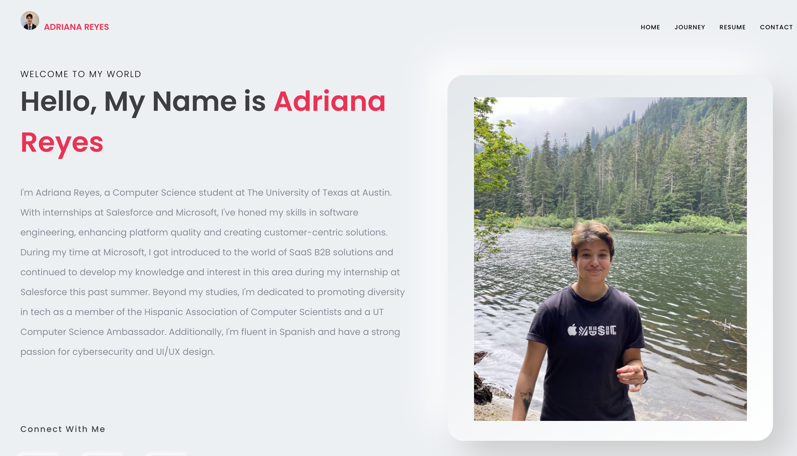
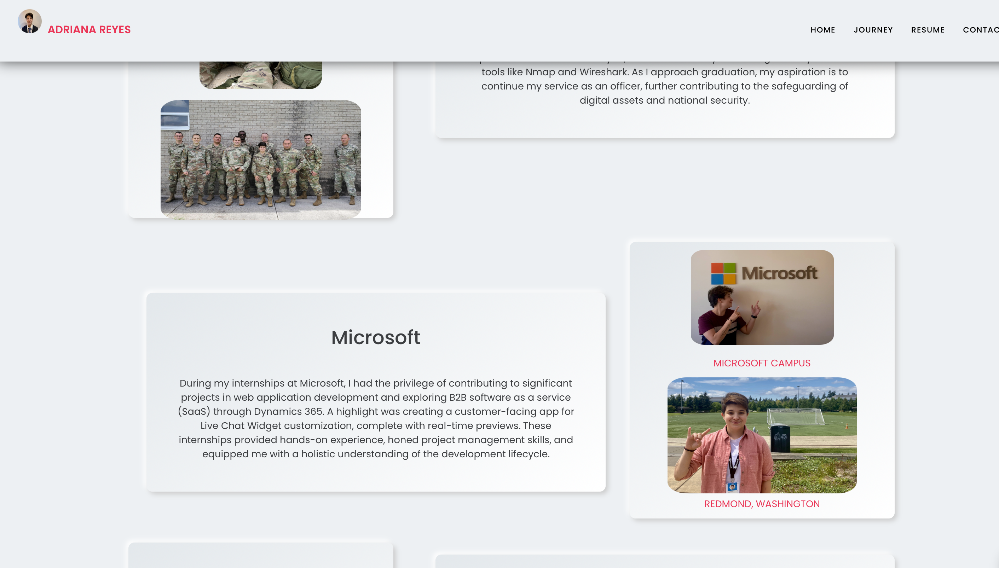
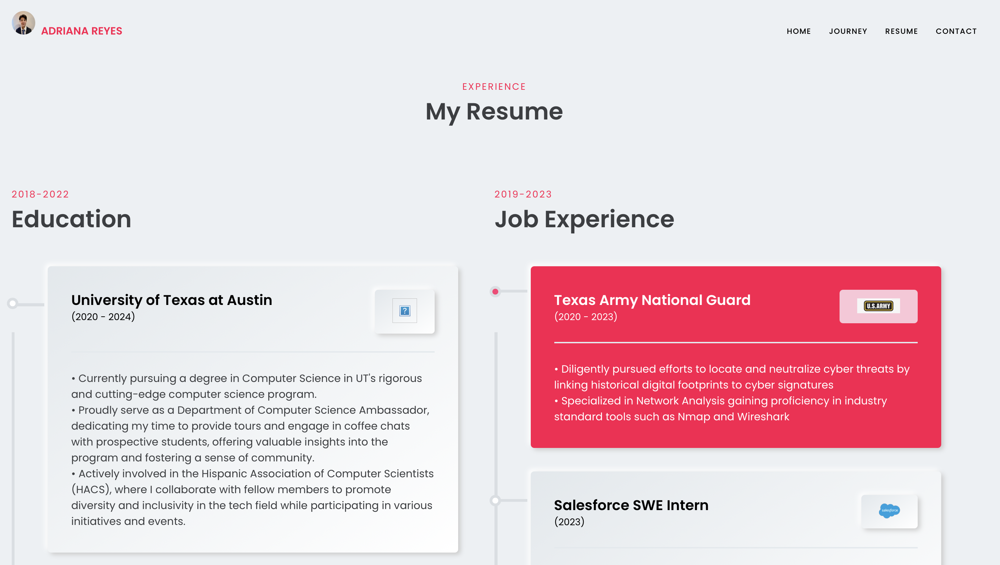

# 🌐 Adriana Reyes - Personal Portfolio Website (v1)

Welcome to the repository for the first iteration of my personal portfolio website! This project was built to showcase my software engineering journey, technical skills, academic background, and personal projects in a clean, interactive single-page application experience.

🚀 **Live Demo:** [areye2020.github.io/my-app](https://areye2020.github.io/my-app/)

---

## ✨ Features & Screenshots

* **Hero & Social Connect:** Clean landing section introducing my background with quick-connect tiles linking directly to my LinkedIn, GitHub, and Email.
* **Technologies & Tech Stack:** Interactive grid display showcasing key programming languages, frameworks, and tools.
* **Multi-Page Navigation:** Smooth navigation across **Home**, **Journey**, **Resume**, and **Contact** pages.
* **Dynamic Navbar:** Clean floating top navigation bar that smoothly transitions visual state upon page scroll.
* **Responsive UI:** Designed using modular CSS components for flexible viewing across web and mobile browsers.

---

## 🛠️ Built With

* **Frontend Framework:** React (Create React App)
* **Styling:** CSS3 / CSS Modules
* **Icons & Assets:** Custom SVG logos & React Icons
* **Deployment:** GitHub Pages (`gh-pages`)

---

## ✨ Features & Screenshots

Here is a look at what the original portfolio website looked like:

### 🏠 Home Page & Intro


### 🛠️ Technologies & Skills Section


### 📄 Resume & Experience Page


---

## 🚀 Getting Started Locally

To run this project locally on your machine, follow these steps:

### Prerequisites
Make sure you have **Node.js** and **npm** installed.

### Installation

1. **Clone the repository:**
   ```bash
   git clone [https://github.com/areye2020/my-app.git](https://github.com/areye2020/my-app.git)
   cd my-app

2. **Install dependencies:
   ```bash
   npm install

3. **Start the development server:
   ```bash
   npm start
   Open http://localhost:3000 in your browser to view the application.

📬 Contact & Links
LinkedIn: linkedin.com/in/adriana-reyes
GitHub: @areye2020


